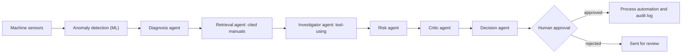

# 🛡️ MachinaGuard AI

### *Detect the failure before the machine does.*

[](https://github.com/m-umar-ai/machinaguard-ai/actions)


An AI operations system for factories. It watches machine sensors, investigates anomalies with specialised AI agents, backs every recommendation with cited maintenance guidance, **challenges its own diagnosis**, and automates the maintenance workflow, **but only after a human approves**.

> 🔗 **Live demo:** _add your Streamlit link here_  ·  📘 [Business model](BUSINESS_MODEL.md)  ·  🎤 [Pitch & demo script](PITCH.md)  ·  🚀 [Deployment guide](DEPLOY.md)

*Built for the Pak Angels Generative & Agentic AI Training, Cohort 11, 2nd Hackathon.*

---

## The business problem
- **Unplanned stoppages are expensive**, and small and mid-size plants rarely have reliability engineers to read vibration data and manuals.
- **Plain threshold alarms fail in two ways:** they catch degradation late, and they raise a *mechanical* alarm when the real fault is a *sensor*. In our benchmark a threshold system did exactly that in 12 of 12 sensor-fault runs, while MachinaGuard recommended checking the sensor in 12 of 12.

## What MachinaGuard does
| Step | What happens | Why it matters to a plant manager |
|---|---|---|
| **Detect** | ML model learns each machine's healthy behaviour and flags drift early | Warning comes before failure, not at failure |
| **Investigate** | A tool-using AI agent checks sensors, trends and redundant readings, and ranks causes | Gets from "something is wrong" to "probably the bearing" |
| **Cite** | Retrieves real passages from maintenance documents; says "no evidence" instead of guessing | Recommendations point to a procedure, not to model memory |
| **Challenge** | A separate Critic agent looks for contradictions, missing evidence and safer alternatives | Lowers confidence when signals disagree |
| **Approve** | Nothing happens without a human click | Safety and accountability stay with people |
| **Automate** | After approval: parts check, draft purchase request, technician match, SLA, English and Urdu notifications, audit log | Turns a diagnosis into scheduled work |



## Business impact (example, every number is an assumption)
Default scenario in the app's **Business & ROI** tab: 20 machines, 0.5 failures per machine per year, 16 h unplanned downtime per failure, $800 per downtime hour, 80% detection rate, 70% of detected failures avoidable.

| | Per year |
|---|---|
| Gross savings | ≈ **$60,480** (≈ Rs 16.9 million at 280 PKR/USD) |
| Subscription (Plant tier, $40 per machine per month) | $9,600 |
| Year-1 net after a $1,500 setup fee | ≈ **$49,380** |
| Break-even detection rate | ≈ **13%**, so the case does not need perfect AI |

These figures are placeholders to be replaced with a pilot customer's real numbers. See the [business model](BUSINESS_MODEL.md) for pricing tiers, go-to-market and risks.

## Evidence (reproducible, see the Validation tab)
| Test | Result |
|---|---|
| Detection, 24 synthetic degradation runs with unseen seeds, speeds and noise (calibrated per machine) | 100% detected; median warning **46 ticks** before failure vs 34 for a fixed 4.5 mm/s threshold |
| False alarms on healthy data | 2 per 1,000 ticks (threshold: 0) |
| Faulty sensor | System recommends a sensor check **12/12**; threshold system raises a mechanical alarm 12/12 |
| Generic model without calibration | 194 false alarms per 1,000 ticks on noisier plants, which is why per-machine calibration is mandatory |
| Document retrieval, 30 questions | Hybrid hit@3 0.93, MRR 0.84; 5 of 5 off-topic questions correctly refused (small test set) |
| Automated tests | 50 tests (`python -m pytest -q`) |

**Honest limits:** all sensor data is synthetic, so this shows robustness, not real-plant performance. Diagnosis signatures are expert-written. All maintenance, purchasing and notification actions are **simulated**; nothing external is contacted. The next step is validation on a public bearing dataset and a pilot plant.

## The five required skills
| Skill | Where it lives | See it in the app |
|---|---|---|
| Multi-Agent Systems | Anomaly, Diagnosis, Retrieval, Investigator, Risk, Critic, Decision and Workflow agents with typed hand-offs and failure isolation | Demo Mode timeline |
| Agentic AI | `agents/agent_loop.py`: tool-using loop, 8 whitelisted tools, step budget, rule-planner fallback | **Agent Trace** tab |
| Generative AI | Cited answers, "Ask the Machine", English and Urdu reports, LLM critic | **Ask** and **Reports** tabs |
| AI Workflows | Retrieval, investigation, critique, decision, approval gate, all audited | Decision trace panel |
| Business Process Automation | `workflows/process_engine.py`: parts, purchase draft, technician, SLA, notifications, audit log | **Approval & Process** tab |

## Quick start
```bash
python -m venv .venv
.venv\Scripts\activate            # Mac/Linux: source .venv/bin/activate
pip install -r requirements.txt
streamlit run app.py
```
Click **🎬 DEMO MODE** for a 2 to 3 minute guided story. The app runs fully offline with no key.

**Optional, live AI:** copy `.env.example` to `.env` and add a Groq or Gemini key. Keys stay in `.env`, which is git-ignored. If a provider hits its limit the app tries the next one, then falls back to offline logic. Verify your setup with `python final_check.py`.

```bash
python -m pytest -q               # 50 tests
python -m rag.evaluate            # retrieval benchmark
python -m validation.benchmark    # detection benchmark (synthetic)
```

## Project layout
```
app.py, core.py          Streamlit control center and session logic
agents/                  the agents and the tool-using agent loop
ml/                      Isolation Forest anomaly detector
rag/                     hybrid retrieval, grounded answers, evaluation
workflows/               approval gate and process automation
genai/                   Ask the Machine, English and Urdu reports
business/                ROI and pricing calculator
simulation/, data/       sensor simulator, maintenance documents, sample inventory
validation/, tests/      benchmarks and automated tests
BUSINESS_MODEL.md        pricing, ROI, go-to-market, risks
PITCH.md, DEPLOY.md      demo script and deployment guide
```

## Roadmap
1. Validate on a public bearing dataset, then a pilot plant (5 to 10 critical machines).
2. Connect to a real maintenance system (CMMS) and WhatsApp Business API.
3. Feedback loop: approved and rejected work orders improve the rules.
4. Multi-plant dashboard.


